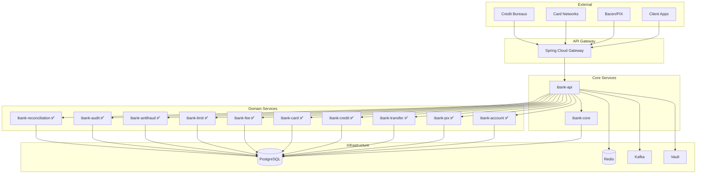

# iBank - Core Banking Platform

> A modular, cloud-native core banking system built with Spring Boot 3, PostgreSQL, and modern Java practices. Designed for Brazilian financial market compliance (Bacen, LGPD, PIX, CNAB).

---

## Architecture



---

## Modules

| Module | Description | Status |
|--------|-------------|--------|
| **ibank-core** | Shared kernel: entities, events, exceptions, security, config | ✅ Done |
| **ibank-account** | Account lifecycle, KYC, statements, balance management | ✅ Done |
| **ibank-pix** | PIX keys, DICT sync, QR codes, instant payments | ✅ Done |
| **ibank-transfer** | TED/DOC/PIX transfers, scheduling, limits, reversal | ✅ Done |
| **ibank-credit** | Loan origination, scoring, amortization, collections | ✅ Done |
| **ibank-card** | Issuing, tokenization, limits, 3DS, disputes | ✅ Done |
| **ibank-fee** | Pricing engine, fee rules, waivers, billing | ✅ Done |
| **ibank-limit** | Risk limits, exposure tracking, real-time enforcement | ✅ Done |
| **ibank-antifraud** | Rules engine, ML scoring, case management, alerts | ✅ Done |
| **ibank-audit** | Immutable event log, tamper-proof trails, compliance | ✅ Done |
| **ibank-reconciliation** | Automated matching, break management, settlement | ✅ Done |

---

## Quick Start

### Prerequisites

- Java 21+
- Maven 3.9+
- PostgreSQL 16+
- Redis 7+
- Kafka 3.6+

### Run All Services

```bash
# Clone
git clone https://github.com/EnzoVieira3012/iBank.git
cd iBank

# Build
mvn clean install -DskipTests

# Start infrastructure
docker-compose up -d postgres redis kafka

# Run migrations
mvn flyway:migrate -pl ibank-core,ibank-account,ibank-pix,ibank-transfer,ibank-credit,ibank-card,ibank-fee,ibank-limit,ibank-antifraud,ibank-audit,ibank-reconciliation

# Start services (each in separate terminal)
mvn spring-boot:run -pl ibank-api
mvn spring-boot:run -pl ibank-account
mvn spring-boot:run -pl ibank-pix
# ... etc
```

### Docker Compose (Full Stack)

```bash
docker-compose -f docker-compose.yml -f docker-compose.prod.yml up -d
```

---

## Configuration

Each module uses `application.yml` with environment-specific overrides:

```yaml
spring:
  datasource:
    url: ${DB_URL:jdbc:postgresql://localhost:5432/ibank_xxx}
    username: ${DB_USER:ibank}
    password: ${DB_PASSWORD:secret}
  jpa:
    hibernate:
      ddl-auto: validate
  flyway:
    enabled: true

ibank:
  # Module-specific config
  audit:
    checksum:
      secret: ${AUDIT_CHECKSUM_SECRET:change-me-in-production}
  reconciliation:
    daily-cron: "0 0 2 * * ?"
```

**Required Environment Variables:**
- `DB_URL`, `DB_USER`, `DB_PASSWORD` - PostgreSQL connection
- `REDIS_URL` - Redis connection
- `KAFKA_BOOTSTRAP_SERVERS` - Kafka brokers
- `VAULT_ADDR`, `VAULT_TOKEN` - HashiCorp Vault
- `AUDIT_CHECKSUM_SECRET` - 32+ char HMAC secret

---

## API Documentation

| Service | Port | Swagger UI |
|---------|------|------------|
| API Gateway | 8080 | `/swagger-ui.html` |
| Account | 8081 | `/swagger-ui.html` |
| PIX | 8082 | `/swagger-ui.html` |
| Transfer | 8083 | `/swagger-ui.html` |
| Credit | 8084 | `/swagger-ui.html` |
| Card | 8085 | `/swagger-ui.html` |
| Fee | 8086 | `/swagger-ui.html` |
| Limit | 8087 | `/swagger-ui.html` |
| Antifraud | 8088 | `/swagger-ui.html` |
| Audit | 8089 | `/swagger-ui.html` |
| Reconciliation | 8090 | `/swagger-ui.html` |

---

## Postman Collection

Complete API collection with all endpoints organized by module, pre-configured variables, and test scripts.

**Download:**
- [Postman Collection](docs/postman/iBank_Core_Banking_API.postman_collection.json)
- [Postman Environment](docs/postman/iBank_Environment.postman_environment.json)

**Features:**
- 11 modules / 120+ endpoints organized in folders
- Pre-configured environment variables (baseUrl, accessToken, UUIDs)
- Auto-save accessToken after login (test script)
- Bearer token auth pre-configured
- Example request bodies for all POST/PUT endpoints
- Query parameters with sensible defaults
- Ready for local, staging, production environments

**Quick Start:**
1. Import both .json files into Postman
2. Select iBank Environment
3. Update baseUrl if needed (default: http://localhost:8080)
4. Run POST Login -> token auto-saved
5. Start testing!

---

## Testing

```bash
# Unit tests
mvn test

# Integration tests (Testcontainers)
mvn verify -DskipITs=false

# Specific module
mvn test -pl ibank-account

# With coverage
mvn jacoco:report
```

**Test Stack:**
- JUnit 5 + AssertJ
- Testcontainers (PostgreSQL, Kafka, Redis)
- Spring Boot Test
- MockMvc for controllers
- WireMock for external APIs

---

## Security

- **JWT** via Spring Security 6
- **Roles**: ADMIN, ACCOUNT_MANAGER, PIX_OPERATOR, TRANSFER_OPERATOR, CREDIT_ANALYST, CARD_ADMIN, FEE_ADMIN, LIMIT_ADMIN, FRAUD_ANALYST, AUDITOR, RECONCILIATION_ADMIN, RECONCILIATION_VIEW
- **mTLS** between services
- **Vault** for secrets
- **Rate limiting** at Gateway
- **Audit logging** on all mutations

---

## Observability

- **Metrics**: Micrometer + Prometheus + Grafana
- **Tracing**: OpenTelemetry + Jaeger
- **Logging**: Structured JSON + Loki
- **Health**: Spring Boot Actuator + Kubernetes probes

---

## Contributing

1. Fork repository
2. Create feature branch (`git checkout -b feat/amazing-feature`)
3. Commit changes (`git commit -m 'feat: add amazing feature'`)
4. Push branch (`git push origin feat/amazing-feature`)
5. Open Pull Request

### PR Requirements
- [ ] All tests pass
- [ ] Coverage >= 80%
- [ ] Swagger documentation updated
- [ ] Flyway migration included (if DB changes)
- [ ] CHANGELOG.md updated
- [ ] No `DEV_PLAN.md` or `.local` files

---

## License

MIT License - see [LICENSE](LICENSE) details.

---

## Author

**Enzo Vieira**

- GitHub: [@EnzoVieira3012](https://github.com/EnzoVieira3012)
- LinkedIn: [enzovieira3012](https://linkedin.com/in/enzovieira3012)
- Email: [enzovieira.trabalho@outlook.com](mailto:enzovieira.trabalho@outlook.com)

---

## Acknowledgments

- [Spring Boot](https://spring.io/projects/spring-boot) - Framework
- [SpringDoc](https://springdoc.org/) - OpenAPI/Swagger
- [Flyway](https://flywaydb.org/) - Database migrations
- [Testcontainers](https://testcontainers.com/) - Integration testing
- [MapStruct](https://mapstruct.org/) - Mapping
- [Lombok](https://projectlombok.org/) - Boilerplate reduction

---

<div align="center">

**Built with ❤️ using Spring Boot 3, PostgreSQL, and modern Java**

[Report Bug](https://github.com/EnzoVieira3012/iBank/issues) • [Request Feature](https://github.com/EnzoVieira3012/iBank/issues) • [Wiki](https://github.com/EnzoVieira3012/iBank/wiki)

</div>