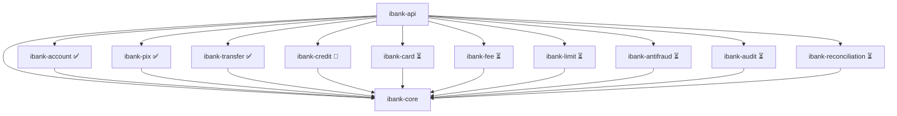

<div align="center">

# 🏦 iBank

**Complete Banking API Platform** built with Spring Boot 3, Java 21, PostgreSQL, and modern DevOps practices.

[](https://openjdk.org/projects/jdk/21/)
[](https://spring.io/projects/spring-boot)
[](https://maven.apache.org/)
[](https://www.postgresql.org/)
[](https://docs.docker.com/compose/)
[](https://swagger.io/specification/)
[](https://jwt.io/)
[](LICENSE)
[]()

[]()
[]()
[]()

</div>

---

## 📋 Overview

iBank is a **production-ready banking API** demonstrating enterprise-grade patterns:

| Domain | Capabilities | Status |
|--------|--------------|--------|
| 🏦 **Accounts** | Current, Savings, Salary, Payment accounts with balance management | ✅ Done |
| ⚡ **PIX** | Keys (CPF/CNPJ/Email/Phone/Random), Payments, QR Codes (static/dynamic), Refunds, Mock DICT | ✅ Done |
| 💸 **Transfers** | TED (17h cutoff), Internal (instant), Scheduled, Cancellation, Idempotency | ✅ Done |
| 🏗️ **Credit** | Loans & Financing with Price/SAC/Sacador tables, Early settlement, Renegotiation | 🚧 In Progress |
| 💳 **Cards** | Credit/Debit/Multiple/Prepaid, Invoices, Installments, Transaction authorization | ⏳ Planned |
| 💰 **Fees & Interest** | Versioned fee tables, Rotary interest, Savings yield, Overdraft | ⏳ Planned |
| 🔒 **Limits** | Daily/Monthly limits, Auto-block on breach, Overdraft control | ⏳ Planned |
| 🛡️ **Antifraud** | Velocity, Device fingerprint, Geo-location, Risk scoring, Auto-block/Challenge | ⏳ Planned |
| 📜 **Audit** | Immutable logs (partitioned), Correlation ID tracing, LGPD/Bacen compliance | ⏳ Planned |
| 📊 **Reconciliation** | CNAB 240/400 import, Automated matching, Discrepancy resolution, Reports | ⏳ Planned |

---

## 🏗️ Architecture

```
┌─────────────────────────────────────────────────────────────────────────────┐
│                              ibank-api (Presentation)                       │
│  ┌──────────┐ ┌──────────┐ ┌──────────┐ ┌──────────┐ ┌──────────────────┐  │
│  │  Auth    │ │ Accounts │ │   PIX    │ │ Transfers│ │   ... 10 more    │  │
│  │Controller│ │Controller│ │Controller│ │Controller│ │    Controllers   │  │
│  └────┬─────┘ └────┬─────┘ └────┬─────┘ └────┬─────┘ └────────┬─────────┘  │
└───────┼─────────────┼─────────────┼─────────────┼──────────────┼───────────┘
        ▼             ▼             ▼             ▼              ▼
┌─────────────────────────────────────────────────────────────────────────────┐
│                           Domain Modules (JARs)                             │
│  ┌────────┐ ┌────────┐ ┌──────┐ ┌──────────┐ ┌────────┐ ┌──────────────┐  │
│  │ account│ │  pix   │ │transfer│ │ credit  │ │ card  │ │  fee/limit   │  │
│  └────────┘ └────────┘ └──────┘ └──────────┘ └────────┘ └──────────────┘  │
│  ┌──────────┐ ┌───────────┐ ┌─────────┐ ┌────────────────┐                │
│  │antifraud │ │  audit    │ │reconcil.│ │     core       │                │
│  └──────────┘ └───────────┘ └─────────┘ └────────────────┘                │
└─────────────────────────────────┬─────────────────────────────────────────┘
                                  ▼
┌─────────────────────────────────────────────────────────────────────────────┐
│                         Infrastructure Layer                                │
│  ┌──────────────┐ ┌──────────────┐ ┌──────────────┐ ┌──────────────────┐  │
│  │ PostgreSQL 16│ │  Flyway      │ │  Redis*      │ │  Kafka*          │  │
│  │  (Docker)    │ │  Migrations  │ │  (Cache)     │ │  (Events)        │  │
│  └──────────────┘ └──────────────┘ └──────────────┘ └──────────────────┘  │
└─────────────────────────────────────────────────────────────────────────────┘
```

### Module Dependency Graph



---

## 🚀 Quick Start

### Prerequisites

- **Java 21+** (Temurin/Oracle/Corretto)
- **Maven 3.9+** (or use included `mvnw` wrapper)
- **Docker & Docker Compose** (for PostgreSQL + pgAdmin)
- **Git**

### 1. Clone & Setup

```bash
git clone https://github.com/EnzoVieira3012/iBank.git
cd iBank
```

### 2. Start Database

```bash
docker-compose up -d
# PostgreSQL: localhost:5432 (ibank/ibank)
# pgAdmin:    localhost:5050 (admin@ibank.local / admin)
```

### 3. Build & Run

```bash
# Build all modules
./mvnw clean install

# Run API (from root or ibank-api module)
./mvnw spring-boot:run -pl ibank-api
```

### 4. Access Points

| Service | URL | Credentials |
|---------|-----|-------------|
| **Swagger UI** | http://localhost:8080/swagger-ui.html | - |
| **OpenAPI JSON** | http://localhost:8080/v3/api-docs | - |
| **Actuator Health** | http://localhost:8080/actuator/health | - |
| **Prometheus Metrics** | http://localhost:8080/actuator/prometheus | - |
| **pgAdmin** | http://localhost:5050 | admin@ibank.local / admin |

---

## 🔐 Authentication

### Test Users (pre-configured)

| Username | Password | Role | Permissions |
|----------|----------|------|-------------|
| `admin` | `admin123` | `ADMIN` | Full access + admin endpoints |
| `manager` | `manager123` | `MANAGER` | Write access to all domains |
| `operator` | `operator123` | `OPERATOR` | Read/Write operational endpoints |
| `client` | `client123` | `CLIENT` | Read own data only |

### Login

```bash
curl -X POST http://localhost:8080/api/v1/auth/login \
  -H "Content-Type: application/json" \
  -d '{"username":"admin","password":"admin123"}'
```

**Response:**
```json
{
  "accessToken": "eyJhbGciOiJIUzI1NiJ9...",
  "refreshToken": "eyJhbGciOiJIUzI1NiJ9...",
  "tokenType": "Bearer",
  "expiresIn": 86400,
  "username": "admin",
  "role": "ADMIN"
}
```

### Using Token

```bash
# All requests require Authorization header
curl -H "Authorization: Bearer <access_token>" \
     -H "Idempotency-Key: $(uuidgen)" \
     http://localhost:8080/api/v1/accounts
```

### Required Headers

| Header | Required | Description |
|--------|----------|-------------|
| `Authorization` | ✅ Yes | `Bearer <JWT>` |
| `Idempotency-Key` | ✅ POST/PUT/PATCH | UUID v4 for idempotency |
| `X-Correlation-ID` | Recommended | UUID for request tracing |

---

## 📚 API Documentation

### Swagger UI Features

- **Try it out** - Execute real requests from browser
- **Persist Authorization** - Token survives page reload
- **Request Duration** - See response times
- **Filter by Tag** - Search endpoints
- **Examples** - Pre-filled request bodies

### API Structure

```
GET    /api/v1/accounts              # List accounts (paginated)
POST   /api/v1/accounts              # Open new account
GET    /api/v1/accounts/{id}         # Get account details
POST   /api/v1/accounts/{id}/block   # Block account
POST   /api/v1/accounts/{id}/unblock # Unblock account

POST   /api/v1/pix/keys              # Register PIX key
GET    /api/v1/pix/keys              # List my PIX keys
DELETE /api/v1/pix/keys/{id}         # Delete PIX key
POST   /api/v1/pix/payments          # Send PIX
GET    /api/v1/pix/payments/{id}     # Get PIX details
POST   /api/v1/pix/payments/{id}/refund # Refund PIX
GET    /api/v1/pix/qrcode            # Generate QR Code

POST   /api/v1/transfers/internal    # Internal transfer
POST   /api/v1/transfers/ted         # TED transfer
POST   /api/v1/transfers/scheduled   # Schedule transfer
GET    /api/v1/transfers/{id}        # Get transfer status

POST   /api/v1/credit/simulate       # Simulate loan
POST   /api/v1/credit/contract       # Contract loan
GET    /api/v1/credit/{id}           # Get loan details
POST   /api/v1/credit/{id}/pay       # Pay installment
POST   /api/v1/credit/{id}/settle    # Early settlement

POST   /api/v1/cards                 # Issue card
GET    /api/v1/cards/{id}            # Get card details
POST   /api/v1/cards/{id}/block      # Block card
GET    /api/v1/cards/{id}/invoice    # Get invoice
POST   /api/v1/cards/{id}/invoice/pay # Pay invoice
```

---

## 🐳 Docker

### docker-compose.yml

```yaml
services:
  postgres:
    image: postgres:16-alpine
    environment:
      POSTGRES_DB: ibank
      POSTGRES_USER: ibank
      POSTGRES_PASSWORD: ibank
    ports: ["5432:5432"]
    volumes: [ibank_pgdata:/var/lib/postgresql/data]
    healthcheck:
      test: ["CMD-SHELL", "pg_isready -U ibank -d ibank"]
      interval: 10s

  pgadmin:
    image: dpage/pgadmin4:8
    environment:
      PGADMIN_DEFAULT_EMAIL: admin@ibank.local
      PGADMIN_DEFAULT_PASSWORD: admin
    ports: ["5050:80"]
    depends_on: [postgres]

volumes:
  ibank_pgdata:
```

### Commands

```bash
# Start
docker-compose up -d

# Logs
docker-compose logs -f postgres

# Stop
docker-compose down

# Stop + remove volumes (clean slate)
docker-compose down -v

# Connect to DB
docker exec -it ibank-db psql -U ibank -d ibank
```

---

## ⚙️ Configuration

### Environment Variables (.env)

```bash
# Application
APP_NAME=ibank
APP_ENV=development
SERVER_PORT=8080

# Database
DB_HOST=localhost
DB_PORT=5432
DB_NAME=ibank
DB_USER=ibank
DB_PASSWORD=ibank
DB_POOL_SIZE=20

# JPA/Hibernate
JPA_DDL_AUTO=validate
JPA_SHOW_SQL=false
JPA_FORMAT_SQL=true

# Flyway
FLYWAY_ENABLED=true
FLYWAY_LOCATIONS=classpath:db/migration

# JWT (CHANGE IN PRODUCTION!)
JWT_SECRET=your-super-secret-min-256-bits
JWT_EXPIRATION=86400000
JWT_REFRESH_EXPIRATION=604800000

# Security
BCRYPT_STRENGTH=12
RATE_LIMIT_REQUESTS=100
RATE_LIMIT_WINDOW_SECONDS=60

# PIX
PIX_DICT_MOCK_ENABLED=true
PIX_QRCODE_EXPIRATION_SECONDS=3600

# Antifraud
ANTIFRAUD_ENABLED=true
ANTIFRAUD_SCORING_THRESHOLD=70

# Audit
AUDIT_PARTITION_MONTHS=60
AUDIT_RETENTION_YEARS=5
```

### Profiles

| Profile | Description |
|---------|-------------|
| `local` | Default - H2 in-memory, no Flyway |
| `dev` | PostgreSQL Docker, Flyway enabled |
| `test` | Testcontainers PostgreSQL |
| `prod` | Production - external DB, SSL, secrets |

---

## 🗄️ Database

### Flyway Migrations

```
src/main/resources/db/migration/
├── V1__create_core_tables.sql      # Users, audit_log (partitioned), reference data
├── V2__create_account_tables.sql   # Accounts, balances, limits
├── V3__create_pix_tables.sql       # PIX keys, transactions, DICT mock
├── V4__create_transfer_tables.sql  # Transfers, schedules
├── V5__create_credit_tables.sql    # Loans, installments, simulations
├── V6__create_card_tables.sql      # Cards, invoices, transactions
├── V7__create_fee_tables.sql       # Fee tables, rules, interest rates
├── V8__create_limit_tables.sql     # Limits, usage, blocks
├── V9__create_antifraud_tables.sql # Rules, alerts, cases, fingerprints
├── V10__create_audit_tables.sql    # Extended audit, data lineage
├── V11__create_reconciliation_tables.sql # Batches, entries, discrepancies
├── V12__create_indexes_partitions.sql    # Performance indexes
└── V13__seed_reference_data.sql    # Additional seed data
```

### Key Design Decisions

- **UUID** for all primary keys (except audit_log BigSerial)
- **Partitioned audit_log** by month (retention: 5 years)
- **Optimistic locking** via `version` column on all entities
- **Soft deletes** via `status` column, no hard deletes
- **JSONB** for flexible metadata, request/response bodies
- **Indexes** on correlation_id, entity lookups, time ranges

---

## 🧪 Testing

### Test Pyramid

```
         ┌─────────────┐
         │  E2E Tests  │  ← ibank-integration (Testcontainers)
         │  (Few)      │
        ┌───────────────┐
        │ Integration   │  ← @SpringBootTest + Testcontainers
        │ Tests (Some)  │
       ┌─────────────────┐
       │   Unit Tests    │  ← JUnit 5 + Mockito (Fast, Many)
       │   (Many)        │
       └─────────────────┘
```

### Commands

```bash
# Unit tests only (fast)
./mvnw test -Dtest=*UnitTest

# Integration tests (requires Docker)
./mvnw test -Dtest=*IntegrationTest

# All tests with coverage
./mvnw clean verify

# Coverage report
open target/site/jacoco/index.html
```

### Test Users in Swagger

1. Open http://localhost:8080/swagger-ui.html
2. Click **Authorize** (🔒 top right)
3. Use any test user credentials
4. Execute endpoints directly!

---

## 📁 Project Structure

```
iBank/
├── .github/workflows/       # CI/CD pipelines
├── .mvn/wrapper/           # Maven wrapper
├── docker-compose.yml      # PostgreSQL + pgAdmin
├── pom.xml                 # Parent POM (dependency management)
├── DEV_PLAN.md            # Development roadmap (gitignored)
├── README.md              # This file
├── ibank-core/            # Domain foundation
│   ├── src/main/java/com/ibank/core/
│   │   ├── exception/     # Business exceptions
│   │   ├── model/         # BaseEntity, enums
│   │   ├── util/          # Money, validators
│   │   └── annotation/    # @Auditable, @Idempotent
│   └── src/main/resources/db/migration/  # Flyway SQL
├── ibank-account/         # Account domain
├── ibank-pix/             # PIX domain
├── ibank-transfer/        # Transfer domain
├── ibank-credit/          # Credit domain
├── ibank-card/            # Card domain
├── ibank-fee/             # Fee/Interest domain
├── ibank-limit/           # Limit/Block domain
├── ibank-antifraud/       # Antifraud domain
├── ibank-audit/           # Audit domain
├── ibank-reconciliation/  # Reconciliation domain
├── ibank-api/             # REST API (Spring Boot App)
│   ├── src/main/java/com/ibank/api/
│   │   ├── config/        # OpenAPI, Security, WebMvc
│   │   ├── controller/    # REST Controllers
│   │   ├── dto/           # Request/Response DTOs
│   │   ├── exception/     # GlobalExceptionHandler, ProblemDetail
│   │   ├── security/      # JWT, Filters, UserDetailsService
│   │   └── IbankApiApplication.java
│   └── src/main/resources/application.yml
└── ibank-integration/     # Integration tests
    └── src/test/java/...  # Testcontainers base, scenarios
```

---

## 🔧 Development

### Adding a New Module

1. Create folder `ibank-newmodule/`
2. Add `pom.xml` with parent reference
3. Add module to parent `pom.xml` `<modules>`
4. Add dependency in `ibank-api/pom.xml`
5. Implement domain logic
6. Add Flyway migration `Vx__create_newmodule_tables.sql`
7. Create Controller + DTOs in `ibank-api`
8. Write tests

### Code Style

- **Java 21** - Records, Pattern Matching, Virtual Threads
- **Lombok** - `@Data`, `@Builder`, `@RequiredArgsConstructor`
- **MapStruct** - DTO mapping (compile-time)
- **Records** for DTOs (Java 16+)
- **Sealed interfaces** for domain hierarchies
- **Optional** for nullable returns

### Git Workflow

```bash
# Feature branch from develop
git checkout develop
git pull
git checkout -b feat/new-feature

# Commit with conventional messages
git commit -m "feat(account): add account closure endpoint"

# Push and create PR
git push -u origin feat/new-feature
# PR: develop ← feat/new-feature
```

### Commit Convention

```
<type>(<scope>): <subject>

Types: feat, fix, docs, style, refactor, test, chore, perf
Scopes: account, pix, transfer, credit, card, fee, limit, antifraud, audit, recon, core, api, config
```

---

## 📈 Observability

### Health Checks

```bash
# Liveness
curl http://localhost:8080/actuator/health/liveness

# Readiness
curl http://localhost:8080/actuator/health/readiness

# Full health (with DB)
curl http://localhost:8080/actuator/health
```

### Metrics (Prometheus)

```bash
curl http://localhost:8080/actuator/prometheus
```

Key metrics exposed:
- `http_server_requests_seconds` - Request latency
- `hikaricp_connections_*` - DB pool
- `jvm_memory_*` - Memory usage
- `process_cpu_usage` - CPU
- Custom: `ibank.transactions.total`, `ibank.fraud.alerts`

### Logging

```yaml
logging:
  level:
    com.ibank: DEBUG
    org.springframework.security: DEBUG
  pattern:
    console: "%d{yyyy-MM-dd HH:mm:ss.SSS} [%thread] %-5level %logger{36} - %msg%n"
```

**Correlation ID** automatically added to all log lines via MDC.

---

## 🔒 Security

### Implemented

- ✅ JWT RS256 (stateless)
- ✅ BCrypt password hashing (strength 12)
- ✅ Role-based access control (ADMIN, MANAGER, OPERATOR, CLIENT)
- ✅ Method-level security (`@PreAuthorize`)
- ✅ Rate limiting (100 req/min/IP)
- ✅ CORS configuration
- ✅ Security headers (CSP, HSTS, X-Frame-Options)
- ✅ Input validation (Bean Validation)
- ✅ Idempotency keys
- ✅ Audit logging (all mutations)

### Production Checklist

- [ ] Rotate JWT secret (256-bit minimum)
- [ ] Enable HTTPS/TLS
- [ ] Configure external secret management (Vault/AWS Secrets)
- [ ] Enable WAF
- [ ] Set up SIEM log forwarding
- [ ] Configure backup/restore for PostgreSQL
- [ ] Enable database encryption at rest
- [ ] Set up penetration testing schedule

---

## 🚢 Deployment

### Docker Image

```dockerfile
# Multi-stage build
FROM eclipse-temurin:21-jdk-alpine AS builder
WORKDIR /app
COPY .mvn .mvn
COPY mvnw pom.xml ./
COPY ibank-core ibank-core
COPY ibank-api ibank-api
RUN ./mvnw clean package -pl ibank-api -am -DskipTests

FROM eclipse-temurin:21-jre-alpine
WORKDIR /app
COPY --from=builder /app/ibank-api/target/*.jar app.jar
EXPOSE 8080
ENTRYPOINT ["java", "-jar", "app.jar"]
```

### Kubernetes (Helm)

```yaml
# values.yaml
replicaCount: 3
image:
  repository: ibank/api
  tag: latest
service:
  type: ClusterIP
  port: 8080
ingress:
  enabled: true
  host: api.ibank.example.com
  tls: true
env:
  - name: DB_HOST
    valueFrom:
      secretKeyRef:
        name: ibank-db
        key: host
```

---

## 🤝 Contributing

1. Fork the repository
2. Create feature branch (`git checkout -b feat/amazing-feature`)
3. Commit changes (`git commit -m 'feat: add amazing feature'`)
4. Push to branch (`git push origin feat/amazing-feature`)
5. Open Pull Request

### PR Requirements

- [ ] All tests pass
- [ ] Coverage ≥ 80%
- [ ] Swagger documentation updated
- [ ] Flyway migration included (if DB changes)
- [ ] CHANGELOG.md updated
- [ ] No `DEV_PLAN.md` or `.local` files

---

## 📄 License

MIT License - see [LICENSE](LICENSE) for details.

---

## 🙏 Acknowledgments

- [Spring Boot](https://spring.io/projects/spring-boot) - Framework
- [SpringDoc](https://springdoc.org/) - OpenAPI/Swagger
- [Flyway](https://flywaydb.org/) - Database migrations
- [Testcontainers](https://testcontainers.com/) - Integration testing
- [MapStruct](https://mapstruct.org/) - Mapping
- [Lombok](https://projectlombok.org/) - Boilerplate reduction

---

<div align="center">

**Built with ☕ by the iBank Team**

[Report Bug](https://github.com/EnzoVieira3012/iBank/issues) • [Request Feature](https://github.com/EnzoVieira3012/iBank/issues) • [Wiki](https://github.com/EnzoVieira3012/iBank/wiki)

</div>